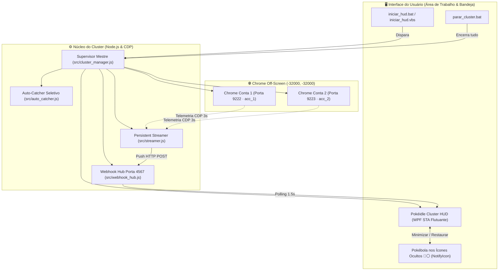

<div align="center">

# 🎮 Pokéidle.io — 24/7 Multi-Account Cluster & Native Windows HUD

### *Automação Dual-Account, Telemetria Persistente CDP e Interface WPF na Bandeja do Sistema*

[](https://pokeidle.io/app)
[](https://nodejs.org/)
[](https://microsoft.com/powershell)
[](https://chromedevtools.github.io/devtools-protocol/)
[](LICENSE)
[](https://github.com/RaFeltrim)

<p align="center">
  <strong>Ecossistema industrial de automação e monitoramento contínuo para Pokéidle.io (https://pokeidle.io/app).<br>
  Opera em segundo plano off-screen em portas isoladas (9222 e 9223), com captura seletiva de 66 espécies e Shinies, watchdog auto-cura de Centro Pokémon e interface nativa Windows WPF integrada aos Ícones Ocultos da bandeja do sistema.</strong>
</p>

[Informações Gerais](#-informações-gerais) •
[Arquitetura do Cluster](#-arquitetura-do-cluster-247) •
[Estrutura do Repositório](#-estrutura-oficial-do-repositório) •
[Documentação Técnica](#-documentação-técnica) •
[Auto-Catcher & Anti-Idle](#-auto-catcher-seletivo--anti-idle) •
[Como Operar](#-como-operar-o-cluster) •
[Autor](#-autor)

</div>

---

## 📌 Informações Gerais

- **Plataforma Alvo:** [Pokéidle.io](https://pokeidle.io/) (Cliente Web: [https://pokeidle.io/app](https://pokeidle.io/app))
- **Lançamento Oficial:** `07/09/2026` (*Fasi Sistemas e Tecnologias / Pedro Henrique Reis Rodrigues*)
- **Escala do Jogo:** 1.277 Espécies (Gerações 1 a 9), 752 Hunts, 796 Shinies, 18 Ginásios Elementais e Outlands 1 a 8.
- **Topologia do Cluster:** Dual-Account Off-Screen (`--window-position=-32000,-32000`)
  - **Conta 1 (Porta 9222):** `Submarino` (Charmander Nv. 28 · Rota de Paras Nv. 1 · Perfil `acc_1`)
  - **Conta 2 (Porta 9223):** `Submarino2` (Bulbasaur Nv. 28 · Rota de Geodude Nv. 1 · Perfil `acc_2`)
- **Saldo Consolidado:** **+2.200.000 Coins** acumuladas autonomamente em farm contínuo.
- **Repositórios Oficiais no GitHub:**
  - 🔒 **Privado:** [`RaFeltrim/pokeidle-cluster-private`](https://github.com/RaFeltrim/pokeidle-cluster-private)
  - 🌐 **Público (Open-Source):** [`RaFeltrim/pokeidle-cluster-free`](https://github.com/RaFeltrim/pokeidle-cluster-free)

---

## 🏗️ Arquitetura do Cluster 24/7

O sistema foi arquitetado para concorrência resiliente e isolamento físico absoluto, permitindo ao usuário navegar normalmente no seu navegador pessoal sem qualquer colisão de sessão.



---

## 🗂️ Estrutura Oficial do Repositório

```text
PokeIdle/
├── 📁 .agents/                                # Diretrizes e fluxos operacionais Antigravity
│   ├── 📁 rules/
│   │   └── pokeidle-core-rules.md             # Regras permanentes (P5, Shinies, Inicial P2, Regra da Outland)
│   └── 📁 workflows/
│       ├── setup-conta-zero.md                # /setup-conta-zero (Auditoria inicial e onboarding)
│       └── ciclo-jornada-auto.md              # /ciclo-jornada-auto (Anti-idle e troca de hunt)
│
├── 📁 docs/                                   # Documentação Técnica Oficial (7 Tratados Especializados)
│   ├── 01-ecossistema-e-rotas.md              # Economia tripartida (Coins, Gemas RMT e Diamantes)
│   ├── 02-matematica-e-pilares-de-forca.md    # 4 Pilares: Qualidade, IVs (Speed CDR), Potência e Shinies
│   ├── 03-mecanicas-de-combate-e-captura.md   # Mecânicas de combate, drop de loot, Bicicleta e AoE
│   ├── 04-roteiro-de-progressao-e-marcos.md   # Progressão Nv. 1 ao 300+ (Regra de Ouro da Outland)
│   ├── 05-conformidade-tos-e-extensoes.md     # Análise de Termos de Serviço e anti-throttling
│   ├── 06-arquitetura-antigravity-e-automacao.md # Orquestração CDP e subagente /browser
│   └── 07-cluster-multi-contas-e-hud-windows.md  # Arquitetura completa de cluster e HUD nativa
│
├── 📁 src/                                    # Código-Fonte do Cluster e Automação
│   ├── cluster_manager.js                     # Supervisor Watchdog Mestre (resiliência de portas e processos)
│   ├── auto_heal_and_progression.js           # Motor Inteligente de Auto-Cura e Progressão Elemental de Mapas
│   ├── webhook_hub.js                         # Servidor local de eventos HTTP push (Porta 4567)
│   ├── streamer.js                            # Streamer persistente de telemetria CDP (WebSocket contínuo)
│   ├── auto_catcher.js                        # Auto-Catcher Seletivo DOM (66 alvos + Shinies)
│   ├── analyzer.js                            # Painel de métricas e telemetria de terminal ao vivo
│   ├── cdp_helper.js                          # Conector e gerenciador assíncrono de sessões CDP
│   ├── roster_evaluator.js                    # Avaliador competitivo de espécimes (Fórmula IV/192 + CDR)
│   ├── hud_windows.ps1                        # HUD Nativa Windows (WPF Master-Detail + System Tray)
│   ├── hud_injector.js                        # Overlay HTML/CSS compacto injetado diretamente no jogo
│   ├── fast_poller.js                         # Poller de fallback para leitura local de porta
│   ├── launch_multi_profiles.js               # Gerenciador de múltiplos perfis de dados do Chrome
│   ├── account_creator.js                     # Automação de onboarding e criação de contas
│   └── orchestrator.py                        # Pipeline Python assíncrona de supervisão
│
├── 📁 data/                                   # Armazenamento e Histórico de Telemetria
│   ├── cluster_config.template.json           # Template de configuração de contas e credenciais
│   ├── game_history.json                      # Histórico de snapshots de telemetria
│   ├── live_events.json                       # Buffer dos últimos 300 eventos em tempo real
│   ├── kanto_hunts_status.json                # Mapeamento das 146 áreas de caça de Kanto
│   ├── ui_elements.json                       # Mapeamento do DOM do Pokéidle
│   └── full_pokedex.txt                       # Base consolidada de atributos das espécies
│
├── iniciar_hud.bat                            # Lançador rápido da HUD nativa
├── iniciar_hud.vbs                            # Lançador 100% silencioso (sem janela de terminal)
├── iniciar_cluster.bat                        # Inicializador completo do cluster de farm
├── parar_cluster.bat                          # Encerramento seguro de 1 clique de todos os processos
├── mcp_config.json                            # Configuração de ferramentas MCP para IDEs
├── package.json                               # Dependências Node.js (ws)
├── .gitignore                                 # Blindagem de dados sensíveis e históricos locais
└── README.md                                  # Este documento
```

---

## 📑 Documentação Técnica

| # | Documento | Escopo e Conteúdo Técnico |
| :---: | :--- | :--- |
| **01** | [Ecossistema, Rotas e Economia](docs/01-ecossistema-e-rotas.md) | Arquitetura web de `pokeidle.io/app`, economia tripartida (Coins, Diamantes 💎, Gemas 💠 RMT Solana USDT), regras de custódia (*escrow*), taxa diária de 100k Coins e comissões de mercado. |
| **02** | [Matemática e Pilares de Força](docs/02-matematica-e-pilares-de-forca.md) | Os 4 pilares: Qualidade ($\ge 1.3$ no inicial), IVs (1 a 32 — Speed como atributo supremo do CDR), Potência (P1 a P5 — P5 dobra atributos) e Shinies (multiplicador $3\times$, taxa base 1/24.000). |
| **03** | [Mecânicas de Combate e Captura](docs/03-mecanicas-de-combate-e-captura.md) | Combate automático, conversão instantânea de loot em ouro, janela de captura de 30s, piso/teto de 0,3% a 10%, Auto-Poção, Auto-Revive e os dois aceleradores de farm: **Bicicleta** e **TM AoE**. |
| **04** | [Roteiro de Progressão e Marcos](docs/04-roteiro-de-progressao-e-marcos.md) | Máquina de estados por nível: Kanto Rush Nv. 1-150, PvP Nv. 80, Torneios Nv. 100, Nv. 150 (Outland 1 + 18 Ginásios Elementais — **Regra de Ouro: Shinies NÃO nascem na Outland!**). |
| **05** | [Conformidade ToS e Extensões](docs/05-conformidade-tos-e-extensoes.md) | Diretrizes estritas dos Termos de Serviço, prevenção de suspensão de abas (*Tab Throttling*), proibição de bots de socket e panorama de extensões autorizadas da comunidade. |
| **06** | [Arquitetura Antigravity e Automação](docs/06-arquitetura-antigravity-e-automacao.md) | Integração com subagente `/browser`, Chrome DevTools MCP (`timeoutSeconds: -1`), regras permanentes (`.agents/rules/`) e orquestração contínua via `/schedule` e Python SDK. |
| **07** | [Cluster Multi-Contas & HUD Windows](docs/07-cluster-multi-contas-e-hud-windows.md) | Arquitetura Dual-Account, execução off-screen (`-32000, -32000`), Auto-Catcher seletivo, supervisor mestre, streamer persistente e HUD nativa com ícone na bandeja. |

---

## 🎯 Auto-Catcher Seletivo & Anti-Idle

O motor de captura [`src/auto_catcher.js`](src/auto_catcher.js) atua diretamente no DOM através de um `MutationObserver` ultraveloz com fallback de polling de 200ms sobre a lista de caídos (`#caidos-lista`), realizando até 15 arremessos consecutivos até o sucesso da captura.

### 🛡️ Catálogo de 66 Espécies Monitoradas:
* **Tier S (Whales / Megas / Alta Renda):** Larvitar, Pupitar, Tyranitar, Gastly, Haunter, Gengar, Scyther, Scizor, Abra, Kadabra, Alakazam, Bulbasaur, Ivysaur, Venusaur, Squirtle, Wartortle, Blastoise, Charmander, Charmeleon, Charizard, Numel, Camerupt, Riolu, Lucario, Dratini, Dragonite, Bagon, Salamence, Beldum, Metagross, Gible, Garchomp, Torchic, Blaziken, Treecko, Sceptile, Mudkip, Swampert.
* **Tier A (Alto Giro / Meta Inicial):** Geodude, Graveler, Golem, Eevee, Vaporeon, Jolteon, Flareon, Vulpix, Ninetales, Growlithe, Arcanine, Pikachu, Raichu, Pichu, Combee, Vespiquen, Machop, Machamp, Magikarp, Gyarados.
* **✨ Detecção Universal de Shinies:** Prioridade máxima incondicional. Qualquer Pokémon com indicador visual ✨ é arremessado imediatamente a todo custo.

### 🏥 Motor Inteligente de Auto-Cura & Progressão Elemental de Mapas
Caso as poções esgotem e o Pokémon seja derrotado, o Pokéidle transfere a conta para o Centro Pokémon e coloca a sessão no estado `fora da caça`. O motor autônomo [`src/auto_heal_and_progression.js`](src/auto_heal_and_progression.js), integrado de forma persistente no [`src/streamer.js`](src/streamer.js), executa a rotina inteligente em 5 etapas:
1. **Detecção Imediata:** Monitora `fora da caça`, `Centro Pokemon`, HP 0 ou botão `Curar equipe`.
2. **Auto-Cura Instantânea:** Clica em **"Curar equipe"**, restaurando 100% de HP da equipe.
3. **Cálculo de Roadmap Elemental:** Avalia a espécie ativa e seu nível destravado para selecionar alvos com vantagens multiplicadoras de dano ($2\times$ e $4\times$ de fraqueza):
   * **Tipo Fogo (Charmander Nv. 28+):** `Paras` (Nv 1 - Bug/Grass) ➔ `Bulbasaur` (Nv 20 - Grass/Poison) ➔ `Beedrill` (Nv 30) ➔ `Parasect` (Nv 50 - Fraqueza $4\times$) ➔ `Victreebel` (Nv 60) ➔ `Venusaur` (Nv 80) ➔ `Scyther` (Nv 100).
   * **Tipo Planta / Veneno (Bulbasaur Nv. 28+):** `Geodude` (Nv 1 - Rock/Ground $4\times$) ➔ `Diglett` (Nv 10 - Ground $2\times$) ➔ `Rhyhorn` (Nv 30 - Ground/Rock $4\times$) ➔ `Graveler` (Nv 40) ➔ `Onix` (Nv 60) ➔ `Golem` (Nv 80) ➔ `Rhydon` (Nv 100).
   * **Modo Alternativo (`STAY_CURRENT`):** Permite configurar a conta para sempre retornar à mesma área em que estava caçando.
4. **Proteção Anti-Death Loop:** Se o Pokémon sofrer 2 derrotas consecutivas na mesma rota avançada em menos de 60 segundos, o algoritmo recua preventivamente uma rota segura para garantir farm ininterrupto.
5. **Re-engajamento via Pointer Events:** Abre o modal de mapas e despacha a cadeia completa de eventos (`pointerdown`, `mousedown`, `pointerup`, `mouseup`, `click`) no botão da rota e no seu gatilho de ação (`.ml-ir, .ml-acao`).
6. **Notificação Push em Tempo Real:** Dispara evento `AUTO_HEAL_AND_ADVANCE` para o Webhook Hub (porta 4567), atualizando o feed de eventos e a HUD Windows instantaneamente.

---

## 🚀 Como Operar o Cluster

### 1. Início em 1 Clique
Dê um duplo clique em **`iniciar_hud.bat`** (ou **`iniciar_hud.vbs`** para execução sem janela preta).
* O supervisor subirá as duas contas Chrome off-screen nas portas `9222` e `9223`.
* O Webhook Hub será iniciado na porta `4567`.
* O Auto-Catcher será injetado em ambas as contas.
* A **HUD Nativa Flutuante** aparecerá na tela e a **Pokébola (🔴⚪)** será fixada na bandeja do Windows (**Ícones Ocultos**).

### 2. Controle da HUD na Bandeja
* **Minimizar / Fechar (`—` ou `✕`):** Oculta a HUD na bandeja mantendo o farm 100% ativo.
* **Restaurar:** Dê um **duplo clique** (ou clique simples) no ícone da Pokébola perto do relógio.
* **Menu de Contexto:** Clique com o botão direito na Pokébola para acessar *Exibir HUD*, *Ocultar* ou *Sair*.
* **Gerenciamento de Senha:** Clique no card da conta para expandir detalhes e utilize o modal seguro de alteração de senha caso necessário.

### 3. Telemetria Rápida no Console
Para auditoria imediata via terminal:
```bash
node src/analyzer.js
```

### 4. Encerramento Completo
Dê um duplo clique em **`parar_cluster.bat`** para encerrar todos os processos de forma limpa.

---

## 👤 Autor

<div align="center">

**Rafael Feltrim**  
*Staff Software Engineer & AI Systems Architect*  

[](https://github.com/RaFeltrim)
[](https://linkedin.com)

</div>

---

<div align="center">
  <sub>Pokéidle Cluster 24/7 Automation · Desenvolvido com Antigravity IDE & Feltrim's Framework</sub>
</div>
