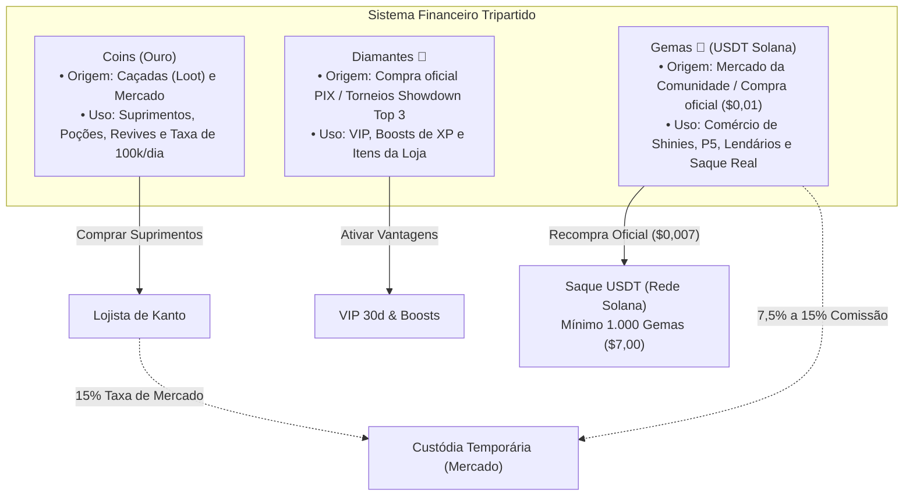

# 01 — Ecossistema, Arquitetura Web e Economia do Pokéidle.io

> **Portal Oficial:** [https://pokeidle.io/](https://pokeidle.io/) | **Cliente Web:** [https://pokeidle.io/app](https://pokeidle.io/app)  
> **Lançamento Oficial:** 7 de setembro de 2026 (Servidor definitivo após encerramento da fase Beta)  
> **Operadora:** Pedro Henrique Reis Rodrigues Desenvolvimento de Software Ltda (Fasi Sistemas e Tecnologias — CNPJ: 68.748.721/0001-18)  
> **Escala do Servidor:** 1.277 Espécies de Pokémon (Gerações 1 a 9 — Kanto a Paldea), 752 Áreas de Caça (*Hunts*) e 796 Formas Shiny.

---

## 1.1. Arquitetura do Cliente Web e Sessão

O Pokéidle.io opera como um MMORPG incremental executado inteiramente no navegador via `https://pokeidle.io/app`. 

### A Limitação Técnica Central: Ausência de Caça Offline
O servidor processa os ciclos de combate apenas enquanto a conexão WebSocket do cliente permanecer ativa com foco em primeiro plano.
- Caso o separador do navegador entre em suspensão de segundo plano (*Tab Throttling*), o combate, o ganho de XP e a conversão de loot em ouro **cessam imediatamente**.
- A persistência 24/7 depende da operação do Google Chrome (v144+) com depuração remota e Modo Economia (*Economy Mode*) ativo.

---

## 1.2. A Economia Tripartida do Jogo

O sistema financeiro do Pokéidle.io divide-se em três moedas com papéis e dinâmicas de liquidez distintas:

### Detalhamento das Moedas:

| Moeda | Origem Principal | Aplicação no Jogo | Regras de Conversibilidade e Restrições |
| :--- | :--- | :--- | :--- |
| **Coins (Ouro)** | Conversão automática de loot nas hunts e vendas no Mercado. | Compra de suprimentos (Pokébolas, Poções, Revives) e pagamento da taxa diária de listagem (100k Coins/dia). | Não conversível em dinheiro real. Vendas em Coins no Mercado sofrem **15% de comissão**. |
| **Diamantes 💎** | Compra oficial via PIX/Cartão; prêmio de top 3 em Torneios Showdown (quartas às 21h BRT). | Aquisição de VIP, boosts temporários de XP/Captura e expansões da loja. | Não sacável diretamente. Pode ser negociado no Mercado por Gemas com **15% de comissão**. |
| **Gemas 💠 (RMT)** | Adquiridas por jogadores (US$ 0,01) ou recebidas em vendas no Mercado da Comunidade. | Moeda oficial de troca para Shinies, Pokémon P5, Lendários e itens nobres. | **Conversível em USDT (Solana)**. Taxa de recompra oficial a US$ 0,007 por Gema. **Saque mínimo de 1.000 Gemas (US$ 7,00)**. |

---

## 1.3. Regras do Mercado da Comunidade e Custódia (*Escrow*)

1. **Custódia Temporária e Período de Retenção:**
   - Ao listar um Pokémon ou item, este sai do inventário e entra em custódia automática por no mínimo **2 minutos** antes de permitir alterações ou cancelamento.
   - Cada conta pode manter no máximo **20 anúncios abertos simultaneamente**.
2. **Requisitos Mínimos de Listagem:**
   - Pokémon convencionais: Devem possuir **Nível >= 50** e **Rating >= 3.5**.
   - Shinies, Potência P5, Lendários e Míticos: Isentos de nível e rating (Shinies são anunciados **exclusivamente por Gemas**).
3. **Taxa Diária Obrigatória de 100.000 Coins:**
   - Listar qualquer Pokémon exige pagamento adiantado de **100.000 Coins por dia** (de 1 a 30 dias), independente de o preço ser em Coins ou Gemas. Essa taxa **não é reembolsável** se o item for vendido ou cancelado antes do prazo.
4. **Comissões sobre Vendas em Gemas:**
   - Itens e Diamantes: **15%**.
   - Pokémon até 500 Gemas: **13%**.
   - Pokémon de 501 a 5.000 Gemas: **10%**.
   - Pokémon acima de 5.000 Gemas: **7,5%**.
   - *Nota:* Arredondamento sempre para o inteiro superior.
5. **Itens Bloqueados para Venda Direta:**
   - Z-Moves prontos, AoE TM Disks, Shiny Stones montadas, Ovos Shiny e Mega Stones **não podem ser revendidos** no mercado (apenas seus fragmentos são negociáveis).

