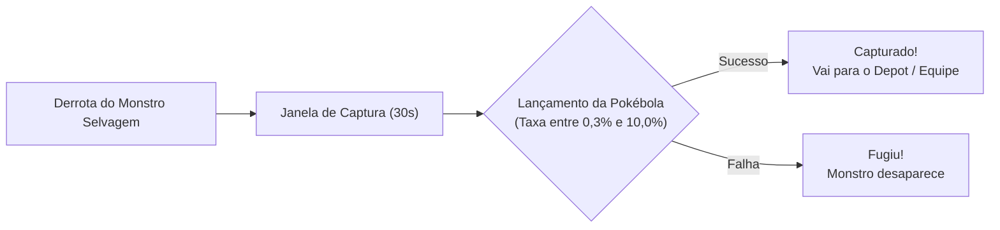

# 03 — Mecânicas de Combate, Janela de Captura e Aceleradores de Farm

O Pokéidle.io elimina a necessidade de cliques manuais no combate direto, mas impõe regras matemáticas rigorosas para a captura, sobrevivência e velocidade de transição entre ondas de inimigos selvagens.

---

## 3.1. Loop de Caça e Conversão Imediata de Loot

1. **Caminhada e Rotação Automática:**
   - O Pokémon em campo desloca-se automaticamente até o alvo mais próximo, acionando golpes na ordem configurada na barra de habilidades.
2. **Conversão de Loot ("Loot virou ouro"):**
   - Para evitar entupimento da mochila, todo o saque genérico (drops cinzas/lixo) é convertido instantaneamente em **Coins** no momento da derrota do inimigo.
   - Itens especiais (pedras de evolução, chaves de Boss, fragmentos de Shiny Stone e itens raros) vão diretamente para a mochila.
3. **Módulos de Sobrevivência:**
   - **Auto-Poção (Auto-Potion):** Injeta poções automaticamente com base no limiar de HP configurado.
   - **Auto-Revive:** Ressuscita o Pokémon caso caia em combate. Poções normais de revive restauram **10% do HP**, enquanto o **Max Revive restaura 100% do HP**.
   - **Retorno à Hunt (Return to Hunt):** Reinsere o Pokémon imediatamente no combate após ser revivido.

---

## 3.2. A Janela de Captura de 30 Segundos e o Teto Matemático de 10%

Ao derrotar um Pokémon selvagem, abre-se uma janela temporal estrita de **30 segundos** para lançar uma Pokébola:

### Regras Matemáticas da Captura:
- **Piso e Teto Absoluto:** A chance de captura situa-se estritamente entre **`0,3%`** e **`10,0%`** por lançamento.
- Mesmo combinando **Capture Boost (2×)**, **Bônus Kick (+15%)** e bolas nobres, **a probabilidade jamais excede 10%**.
- Se a captura de um Pokémon Shiny falhar, o Shiny escapa e é perdido definitivamente.

### Taxas Nominais por Tipo de Bola e Estágio Evolutivo:

| Tipo de Pokébola | 1.º Estágio (Básico) | 2.º Estágio (Intermediário) | 3.º Estágio (Final) |
| :--- | :---: | :---: | :---: |
| **Pokéball Comum** | Baixa (`~0,5%`) | Muito Baixa (`~0,3%`) | Mínimo (`0,3%`) |
| **Great Ball** | Média (`~0,9%`) | Baixa (`~0,6%`) | Muito Baixa (`~0,4%`) |
| **Ultra Ball** | `1,46%` | `1,17%` | `0,94%` |
| **Beast Ball** | **`2,93%`** | **`2,35%`** | **`1,88%`** |

> [!TIP]
> **Vantagens VIP na Captura:** O status VIP não altera as probabilidades matemáticas de captura nem de aparição de Shinies, mas desbloqueia os recursos essenciais **"Lançar até Capturar"** (*Throw until Caught*) e **"Lançar sem Parar"** (*Continuous Throwing*).

---

## 3.3. Os Dois Grandes Aceleradores de Rendimento (XP/h e Ouro/h)

Veteranos e guias da comunidade apontam dois equipamentos que transformam o rendimento da conta:

1. **A Bicicleta (Bicycle):**
   - Reduz drasticamente o tempo de locomoção do Pokémon entre a eliminação de uma onda e a chegada ao próximo grupo de inimigos.
   - Entra diretamente como multiplicador de abates/hora nas ferramentas de telemetria.
2. **O TM Disk AoE (Ataque em Área):**
   - Permite que um único ataque atinja múltiplos Pokémon selvagens simultaneamente nas ondas cheias.
   - Transforma hunts densas em máquinas aceleradas de XP/h e Ouro/h, viabilizando o rush inicial até o Nível 150.

