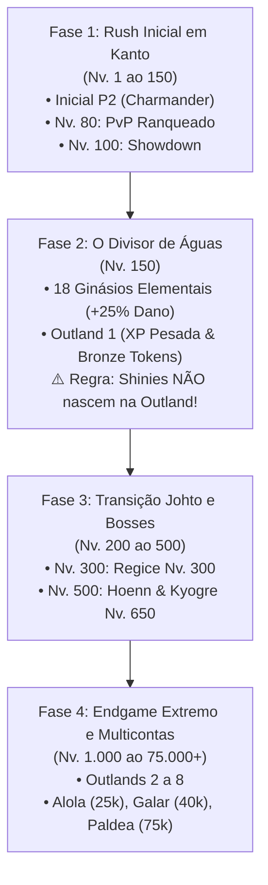

# 04 — Roteiro de Progressão de Níveis e Marcos de Conteúdo

Para conduzir a conta de forma eficiente do Nível 1 ao *Endgame*, o agente autónomo segue a máquina de estados baseada nos bloqueios de nível (*level gates*) do servidor.

---

## 4.1. Linha do Tempo e Marcos Críticos

---

## 4.2. Fase 1: O Rush Inicial em Kanto (Nível 1 ao 150)

### 1. Seleção do Inicial:
- **Charmander (Recomendado):** Alto dano bruto, transição veloz para *Charizard*, acelerando o clear de rotas em Kanto.
- **Squirtle:** Opção focada em defesa e sustentação segura.
- **Bulbasaur:** Equilíbrio de atributos e dano contínuo.

### 2. O Grande Erro de Iniciantes:
- Interromper a subida de nível para tentar caçar Shinies em rotas fracas ou gastar Coins evoluindo monstros P1 com IVs baixos.
- **Diretriz:** Concentrar 100% dos recursos no seu inicial P2 (Qualidade >= 1.3 e IVs > 140) ou em espécies de alto escalamento (*Geodude ➔ Golem*, *Dragonite*, *Tyranitar*, *Garchomp*, *Metagross*, *Lucario*, *Gengar*).

### 3. Marcos Intermediários:
- **Nível 80 — PvP Ranqueado:**
  - Batalhas 1v1 automáticas com equipes de até 5 Pokémon.
  - Ativar sempre a **Escalação Secreta** para esconder a ordem do time dos oponentes.
  - Reset semanal aos **sábados às 23:59 BRT**.
- **Nível 100 — Torneios Showdown:**
  - Ocorrem às **quartas-feiras às 21:00 BRT**.
  - Regras: Pokémon até Nível 150; banidos Shinies, P5, Lendários e TMs. Recompensa Top 3: **Diamantes 💎**.

---

## 4.3. Fase 2: O Divisor de Águas — Nível 150

O Nível 150 destrava simultaneamente os dois sistemas mais lucrativos do jogo:

### 1. Os 18 Ginásios Elementais:
- Conquistar e manter o controle de um ginásio elemental concede um título exclusivo e **+25% de dano bônus em todas as hunts** para Pokémon do tipo correspondente.
- O agente alinha o elemento do Pokémon ativo com o bônus do ginásio conquistado.

### 2. Abertura da Outland 1 e a Regra da Outland:
> [!CAUTION]
> **REGRA CRÍTICA:** Pokémon Shiny **NÃO NASCEM** nas hunts da Outland!  
> Qualquer tentativa de caçar Shinies na Outland resulta em 0% de chance matemática.

- **Para que serve a Outland:**
  - Experiência (XP/h) exponencialmente superior às rotas normais.
  - Materiais de construção de casas.
  - **Bronze Boss Tokens** (chaves de acesso aos chefes).
  - Fragmentos de **Shiny Stone** e **Mega Stones**.
- **Para onde ir para caçar Shinies:** Regressar sempre às rotas regionais convencionais (Kanto, Johto, Hoenn).

---

## 4.4. Fase 3 e 4: Johto, Bosses e Endgame Extremo

| Nível / Marco | Conteúdo Desbloqueado | Requisitos e Estratégia de Combate |
| :---: | :--- | :--- |
| **Nível 200 a 470** | **Rotas de Johto** | Transição de hunts regionais para farming de novos tipos e Shinies de Johto. |
| **Nível 300** | **Boss Regice (Nv. 300)** | Consome **Bronze Boss Token**. Exige time nivelado e rotação com cura rápida. |
| **Nível 500** | **Região de Hoenn** | Hunts de Hoenn com monstros de 3.ª geração. |
| **Nível 650** | **Boss Kyogre (Nv. 650)** | Drop de fragmentos nobres e chance de equipamentos raros. |
| **Nível 1.000 a 36.000** | **Outlands 2 a 8** | Desbloqueadas progressivamente nos níveis 1k, 2k, 4k, 8k, 16k, 24k e 36k. Multiplicadores maciços de Bronze Tokens. |
| **Nível 25.000+** | **Regiões de Late Game** | Alola (Nv. 25.000), Galar (Nv. 40.000) e Paldea (Nv. 75.000). |

