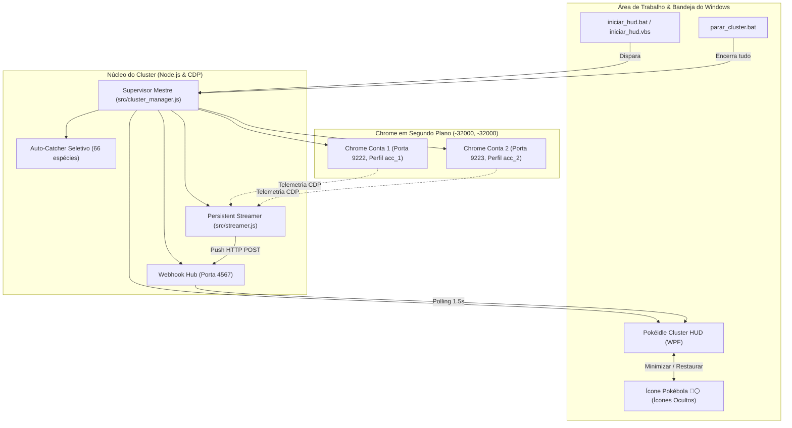

# 07 — Arquitetura de Cluster Multi-Contas & HUD Nativa Windows

> **Projeto:** Pokéidle 24/7 Dual-Account Farming & Native Windows Monitoring  
> **Status Operacional:** ✅ Ativo e Estabilizado (Watchdog Anti-Pausa & Telemetria em Tempo Real)  
> **Saldo Consolidado:** > 660.000 Coins  
> **Contas:** `Conta 1` (Porta 9222 · Charmander Nv. 20) & `Conta 2` (Porta 9223 · Bulbasaur Nv. 17)  

---

## 🏗️ 1. Visão Geral da Arquitetura

O sistema foi desenhado para operar 24 horas por dia, 7 dias por semana, com **zero intervenção manual** e **zero impacto na usabilidade do computador**. O jogador pode utilizar seu navegador Google Chrome pessoal normalmente, enquanto o cluster roda em segundo plano invisível.



---

## 🌐 2. Isolamento de Perfis e Execução Off-Screen

### A. Isolamento do Navegador Pessoal
Cada conta roda em uma pasta de perfil dedicada no Windows:
- **Conta 1 (`Conta 1`):** `C:\temp\pokeidle_profiles\acc_1`
- **Conta 2 (`Conta 2`):** `C:\temp\pokeidle_profiles\acc_2`

Isso garante que o usuário pode abrir, fechar e navegar no seu Google Chrome pessoal normalmente, sem que portas ou sessões colidam.

### B. Modo Off-Screen Físico
Para evitar que navegadores apareçam na tela ou que o Windows suspenda a aba por inatividade (*throttling*), as instâncias são iniciadas com as flags:
```text
--window-position=-32000,-32000
--window-size=1024,768
--disable-background-timer-throttling
--disable-backgrounding-occluded-windows
--disable-renderer-backgrounding
```
- **Resultado:** A janela física existe e renderiza a 60 FPS com aceleração de hardware completa, mas suas coordenadas estão fora de qualquer monitor físico. Zero janelas na tela.

---

## 🎯 3. Auto-Catcher Seletivo ("A Todo Custo")

O script [`src/auto_catcher.js`](src/auto_catcher.js) injeta um `MutationObserver` e um poller de 200ms diretamente no DOM do jogo:
- **Alvos Prioritários (66 Espécies):**
  - **Tier S:** Larvitar, Tyranitar, Gastly, Gengar, Scyther, Scizor, Abra, Alakazam, Riolu, Lucario, Dratini, Dragonite, Bagon, Salamence, Beldum, Metagross, Gible, Garchomp, Iniciais das Gerações 1 a 3 (Charmander, Bulbasaur, Squirtle, Torchic, Treecko, Mudkip).
  - **Tier A:** Geodude, Golem, Eevee e evoluções, Vulpix, Ninetales, Growlithe, Arcanine, Pikachu, Raichu, Combee, Machop, Magikarp, Gyarados.
- **Detecção Universal de Shinies:** Qualquer espécie com a tag `.shiny` ou estrela dourada dispara arremesso contínuo de Pokébolas até a captura ser confirmada.

---

## ⚡ 4. Telemetria Persistente e Prevenção de Prompts

O Chrome moderno exibe um banner de permissão de depuração sempre que uma **nova conexão WebSocket** é aberta.
- **Solução Implementada ([`src/streamer.js`](src/streamer.js)):** O streamer estabelece **uma única conexão WebSocket contínua** com as portas 9222 e 9223. Ela permanece aberta infinitamente, transmitindo métricas a cada 3 segundos via protocolo CDP (`Runtime.evaluate`). O Chrome nunca mais solicita permissão após a primeira conexão.

---

## 🖥️ 5. HUD Nativa Windows & System Tray

A interface nativa foi construída em WPF e PowerShell:
- **Residência nos Ícones Ocultos:** Desenha uma Pokébola (🔴⚪) em alta resolução na área de notificação do Windows.
- **Interação:**
  - **Duplo clique** ou **clique simples** na Pokébola: Alterna a exibição da HUD.
  - **Botão `—` ou `✕`:** Oculta a janela de volta para a bandeja sem parar o farm.
  - **Botão direito:** Menu com opções para Exibir, Ocultar ou Encerrar o Cluster.
- **Visão Master-Detail:**
  - **Visão Geral:** Saldo consolidado, cards individuais das contas, área de caça atual, HP e destaques da última hora.
  - **Visão de Detalhe:** Ao clicar no card de uma conta, expande barras de HP, XP do Pokémon, poder, IVs e histórico individual de eventos. Botão `‹ Voltar ao Cluster` retorna ao resumo.

---

## 🚀 6. Guia Rápido de Comandos

| Arquivo | Função |
| :--- | :--- |
| [`iniciar_hud.bat`](iniciar_hud.bat) | Inicia todo o cluster e a HUD nativa em 1 clique (fecha o CMD em 0.2s). |
| [`iniciar_hud.vbs`](iniciar_hud.vbs) | Inicialização 100% silenciosa (zero janelas de prompt na tela). |
| [`parar_cluster.bat`](parar_cluster.bat) | Encerra com segurança todos os navegadores, servidores Node e a HUD. |
| `node src/analyzer.js` | Exibe o relatório instantâneo de telemetria no terminal. |

